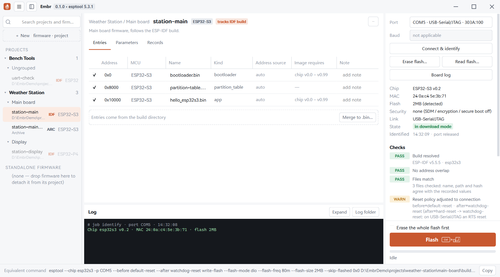

<p align="center">
  
</p>

<h1 align="center">Embr</h1>

<p align="center">A firmware manager and flasher for Espressif chips on Windows.</p>

<p align="center">
  <a href="https://github.com/LuoIsHere/Embr/actions/workflows/ci.yml"></a>
  <a href="LICENSE"></a>
  <a href="https://github.com/LuoIsHere/Embr/releases"></a>
</p>



Embr remembers every firmware you work with: where its files are, which addresses and parameters they are written with, and what each firmware is for. Firmware is organized into projects, firmware that follows an ESP-IDF or PlatformIO build always reflects the latest build, and every flash operation is recorded. Flashing is done by a built-in copy of esptool.

## Features

**Projects and firmware**
- Organize firmware into projects and groups (for example, one group per board), or keep it standalone. Notes, tags and search are available for every firmware.
- Create firmware from `.bin` files, follow an ESP-IDF `build` directory, or follow one or more PlatformIO environments. Files and build folders can be dragged from File Explorer into the sidebar.

**Builds that stay current**
- Followed builds are checked again when a firmware is selected, when the window becomes active, before every flash, and periodically.
- A rebuild that only changes file contents is followed automatically. Any other change (entries, addresses, chip, ESP-IDF version, flash parameters) is listed and must be confirmed before flashing.
- An incomplete build, mixed build output or a target that changed without a rebuild is reported and cannot be flashed.

**Recognition**
- Each file is classified by its content: bootloader, app, partition table, otadata, merged image or file system image.
- Default addresses come from esptool, the partition table and the build output. Every address can be changed.
- Attachments (data the firmware reads from flash) can be placed by partition name or by address.

**Checks before writing**
- Connect & identify reads the chip, revision, MAC address, flash size and security state, then releases the port. Firmware that does not fit the identified chip is dimmed.
- A checklist covers address overlap, file consistency (name, path and SHA-256), chip and chip revision, flash size, reset settings and security features.
- Flashing is refused for chips with flash encryption, Secure Boot or Secure Download Mode enabled, and for images that do not match the chip.

**Flashing and more**
- Flash, erase the whole flash, and read flash to a file. Cancellation works at any stage and always releases the port.
- Merge a firmware into a single `.bin` image.
- Archive a fixed copy of a build, and move projects or firmware between computers as `.embr` packages.
- Every flash, erase and read operation is recorded: time, port, chip, MAC address, the files written with their SHA-256, the result and the equivalent esptool command.

**Interface**
- English and Simplified Chinese; light and dark themes, following the system by default.

## Design principles

- **Portable.** Settings, data, logs and temporary files stay in the program folder. Nothing is written to `%APPDATA%` or the registry.
- **Transparent.** The equivalent esptool command for the selected firmware and port is always shown and can be copied.
- **No lingering connections.** Every operation opens its own connection and releases the port when it ends, so a serial monitor can use it right away.
- **Safety checks are not bypassed.** esptool's `force` option is never used.
- **Your files stay yours.** Deleting a project or firmware removes it from Embr only. It does not delete any `.bin` file or build output.

## Requirements

- Windows 10 or Windows 11, x64.
- No Python installation is needed for the release package.

## Installation

1. Download the latest release package from the [Releases page](https://github.com/LuoIsHere/Embr/releases).
2. Extract it to a writable folder (for example under Documents; not under Program Files).
3. Run `Embr.exe`.

Embr is not code-signed. On first start, Windows SmartScreen may show "Windows protected your PC"; choose **More info**, then **Run anyway**. Security software may also ask for confirmation.

**Upgrading:** replace `Embr.exe` and the `_internal` folder with those of the new version. Keep `data`, `logs` and `settings.ini`, which hold your projects, firmware, records and settings.

## Getting started

1. Create a project with **+ New → New project**.
2. Add firmware with **+ New**: import an ESP-IDF build directory or a PlatformIO build, or create a firmware from `.bin` files. You can also drag files or a build folder into the sidebar.
3. Connect the device and select its port in the panel on the right.
4. Click **Connect & identify** and review the checklist.
5. Click **Flash** (`Ctrl+Enter`). Press `Esc` to cancel.

## Supported chips and build systems

- **Chips:** the chips supported by the built-in esptool 5.3.1, except the ESP8266.
- **ESP-IDF:** build directories that contain `flasher_args.json`.
- **PlatformIO:** the Arduino framework with Arduino core 2.0.x on the official Espressif 32 platform, and the ESP-IDF framework. Projects using Arduino core 3.x (pioarduino) can be imported and flashed, but their support is not guaranteed. Arduino core 1.x is not supported.
- **Not supported:** chips with flash encryption, Secure Boot or Secure Download Mode enabled (these are detected and refused), reading or writing eFuses, and operating systems other than Windows.

## Building from source

Requirements: Python 3.13 and [uv](https://docs.astral.sh/uv/).

```bash
uv sync
```

```bash
uv run embr
```

```bash
uv run pytest
```

When run from source, Embr keeps its data in the `.run` folder of the repository.

## Documentation

- [CHANGELOG.md](CHANGELOG.md): summary of the current version.
- [docs/CHANGELOG.md](docs/CHANGELOG.md): full list of changes in every version.
- [LICENSE](LICENSE): the GNU General Public License, version 3.
- [THIRD_PARTY_NOTICES](THIRD_PARTY_NOTICES): third-party software, fonts and icons included in Embr, with their licenses.

## License and disclaimer

Copyright © 2026 @LuoIsHere

Embr is free software: you can redistribute it and/or modify it under the terms of the GNU General Public License as published by the Free Software Foundation, either version 3 of the License, or (at your option) any later version. See [LICENSE](LICENSE).

Embr is distributed in the hope that it will be useful, but **without any warranty**; without even the implied warranty of merchantability or fitness for a particular purpose. Flashing, erasing and reading flash change or expose the contents of a device. The author accepts no liability for any damage arising from the use of Embr, including damaged devices, lost data or erased or overwritten flash. Back up important data with **Read flash…** before writing to a device.

## Acknowledgements and trademarks

Embr is built on [esptool](https://github.com/espressif/esptool) and [Qt for Python (PySide6)](https://doc.qt.io/qtforpython-6/). It uses the HarmonyOS Sans font and [Lucide](https://lucide.dev) icons. Full details and licenses are in [THIRD_PARTY_NOTICES](THIRD_PARTY_NOTICES).

Espressif, ESP32 and ESP-IDF are trademarks of Espressif Systems (Shanghai) Co., Ltd. PlatformIO is a trademark of PlatformIO Labs. Embr is an independent project and is not affiliated with or endorsed by Espressif Systems or PlatformIO Labs.
